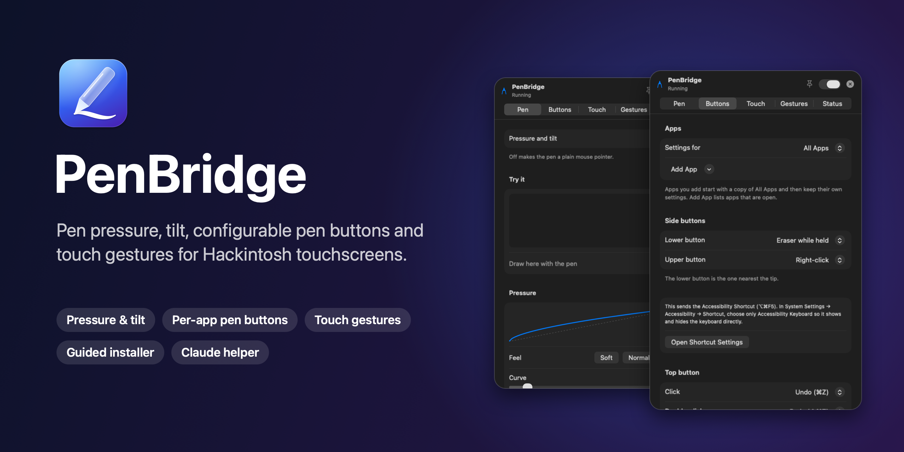
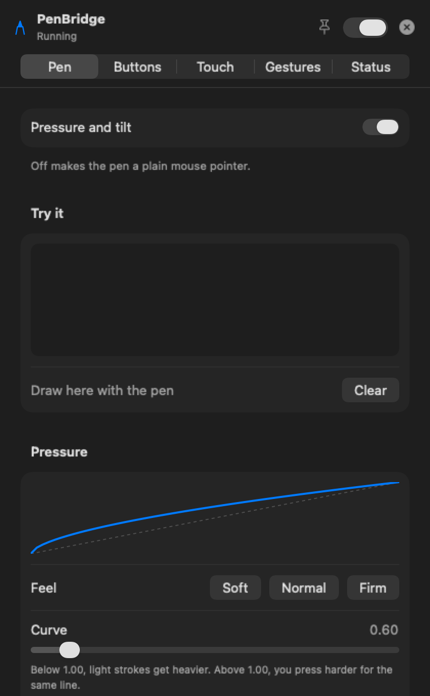
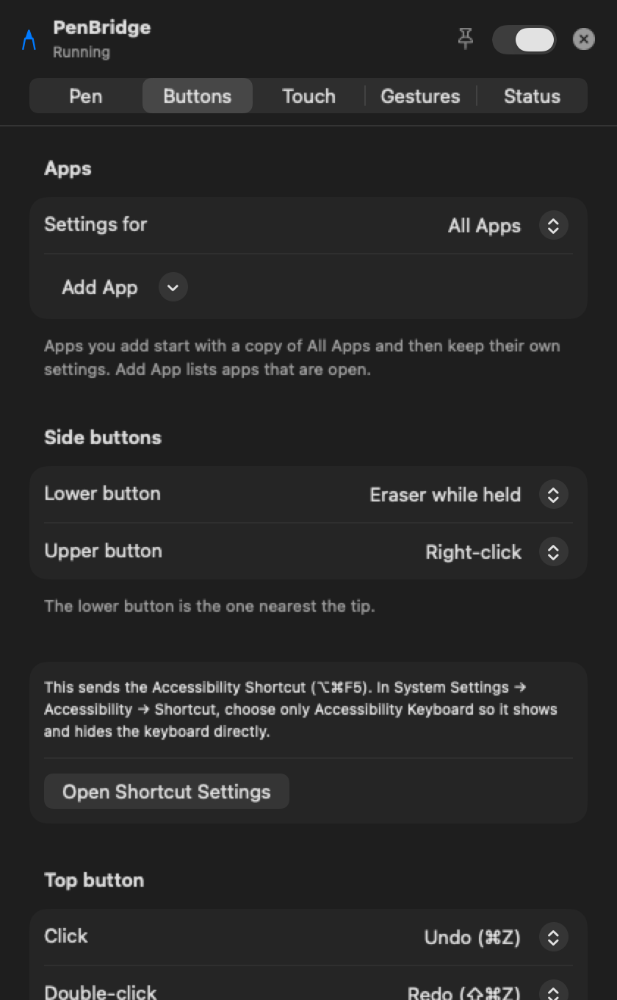
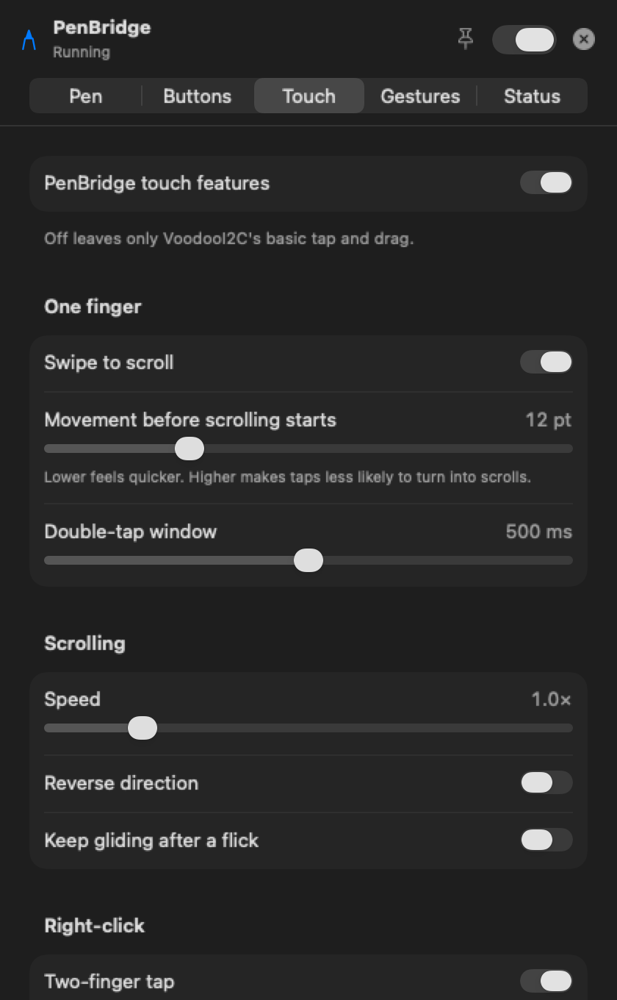
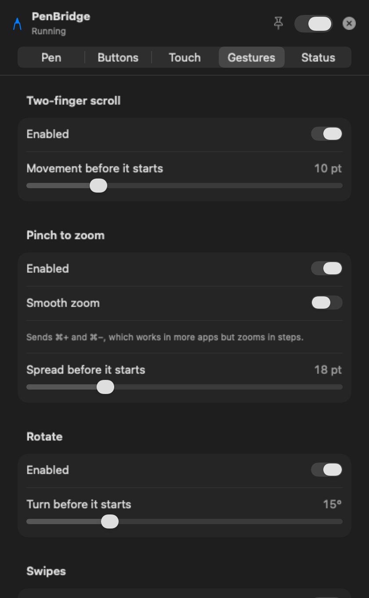
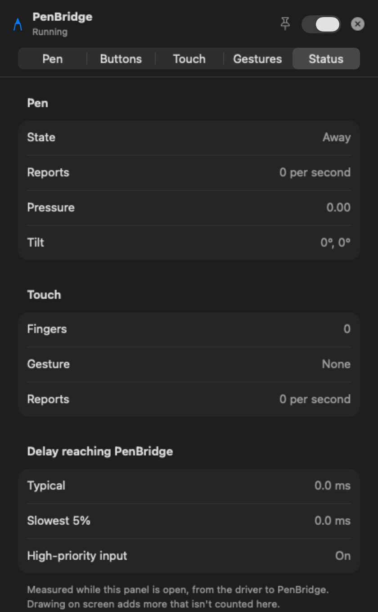
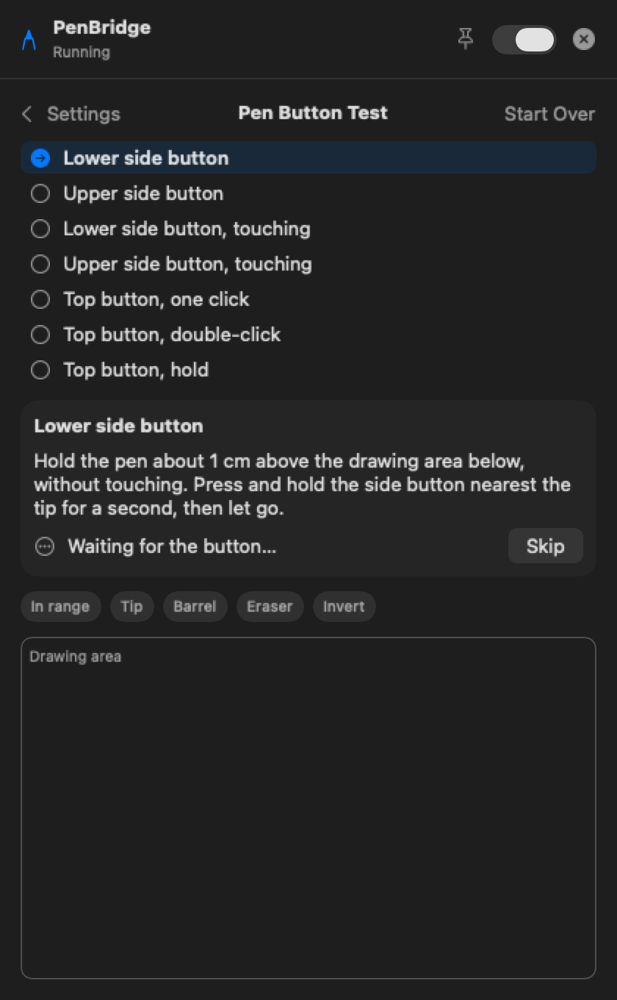
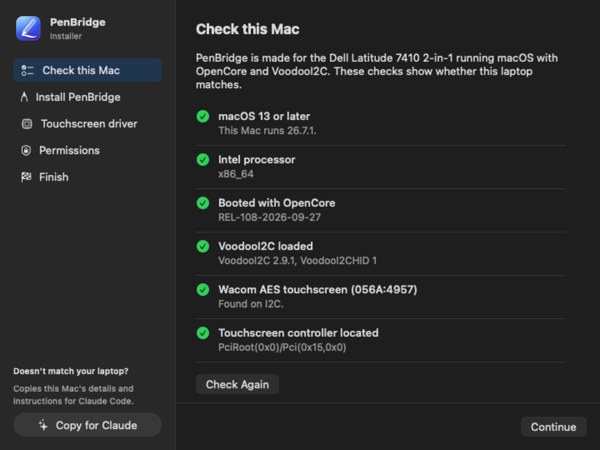
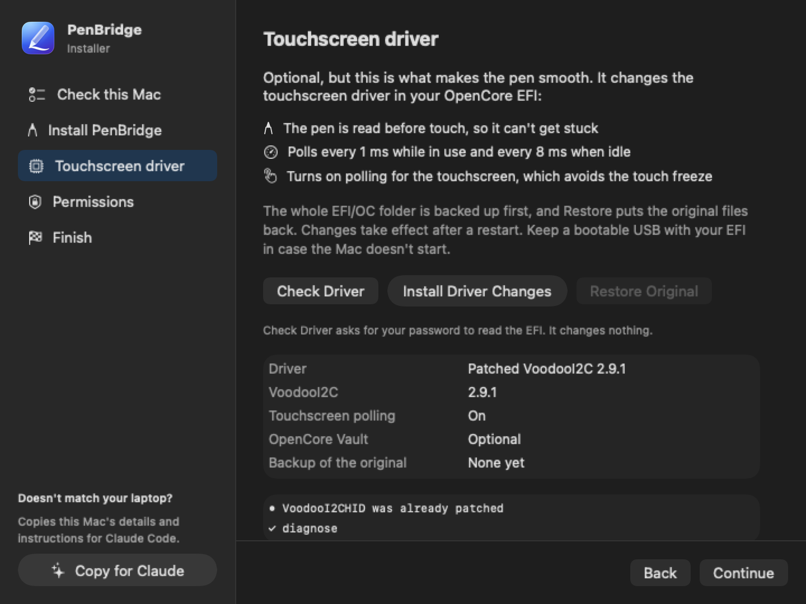

<p align="center">
  
</p>

<p align="center">
  
  
  
  
  
</p>

**PenBridge** gives a Hackintosh touchscreen what VoodooI2C alone can't: real pen pressure
and tilt in drawing apps, an eraser, pen buttons you can map to anything (per app), and
smoother touch gestures. All of it is configured from a menu bar panel. A guided installer
sets everything up, including an optional, reversible driver tune-up for a smooth pen.

It was built and tested on a **Dell Latitude 7410 2-in-1**, and it includes a
**[Claude helper](#-claude-helper-adapt-it-to-your-laptop)** so Claude Code can adapt it
to other touchscreen laptops.

---

## ✨ Features

**Pen**
- Pressure and tilt reach apps like Krita, Photoshop, Affinity, Chrome/Brave and other Wacom-aware apps
- Pressure curve with a live graph, Soft/Normal/Firm presets, full-pressure point, lightest touch and smoothing
- Optional stroke smoothing, palm rejection and eraser support
- Pen test area that draws with the pressure apps actually receive

**Pen buttons**
- Every button is configurable: lower side, upper side, and the top button's click, double-click and hold
- Actions: right/middle click, scroll while touching, eraser while held, eraser on/off, undo/redo,
  any keyboard shortcut you record, Accessibility Keyboard, Mission Control, Spaces, screenshot and more
- **Per-app settings**: different buttons in Krita than in Safari, switched automatically
- Guided **button test** that shows exactly what your pen sends

**Touch**
- One-finger scroll with momentum, two-finger scroll, pinch to zoom, rotate, two-finger tap for right-click
- 3- and 4-finger swipes with a chosen action for each direction
- Every threshold and speed is adjustable

**Setup**
- Guided installer with compatibility checks, no Terminal needed
- Optional VoodooI2C tune-up: pen ~300 reports/s, no stuck pen, lower idle CPU. It's backed up and reversible.
- Menu bar panel with live status (report rates, delay, pressure, gesture)

## 📸 Screenshots

| Pen | Buttons | Touch |
|:---:|:---:|:---:|
|  |  |  |
| **Gestures** | **Status** | **Button test** |
|  |  |  |

### The installer

<p align="center">
  
  
</p>

## 💻 Compatibility

**Built and tested on:**

| | |
|---|---|
| Laptop | Dell Latitude 7410 2-in-1 (i7-10610U, UHD 620) |
| Touchscreen | Wacom AES `WCOM4957` (HID `056A:4957`) on I2C |
| Pen | HP Active Pen G3 (any Wacom AES pen should work; the top button needs Bluetooth pairing) |
| macOS | 26 Tahoe (PenBridge runs on macOS 13 and later) |
| Bootloader | OpenCore 1.0.8 |
| Driver | VoodooI2C 2.9.1 |

**Other laptops:** PenBridge is meant for any Intel Hackintosh whose touchscreen runs on
VoodooI2C. Today it decodes only the Wacom AES `056A:4957` report format, and the
driver tune-up targets VoodooI2C 2.9.1. On a different touchscreen or driver version,
the installer tells you what doesn't match and changes nothing. The Claude helper can
then adapt it for your hardware.

## 📦 Install

1. Download **PenBridge-Installer.zip** from the [latest release](../../releases/latest),
   unzip it, and move the folder somewhere permanent (Documents, for example).
2. Open **PenBridge Installer**. The app isn't notarized, so the first time macOS blocks it:
   open **System Settings → Privacy & Security** and click **Open Anyway**.
3. Follow the five steps:

| Step | What happens |
|---|---|
| **Check this Mac** | macOS, Intel, OpenCore, VoodooI2C, touchscreen and its controller |
| **Install PenBridge** | Copies the app to `~/Applications` and starts it at login. No password. |
| **Touchscreen driver** *(optional)* | Backs up `EFI/OC`, patches your own VoodooI2CHID after checking every byte, turns on touchscreen polling. Has **Restore Original**. Restart afterwards. |
| **Permissions** | Allow **Input Monitoring** and **Accessibility** for PenBridge |
| **Finish** | Summary, plus restart if needed |

> [!IMPORTANT]
> Before the driver step, keep a bootable USB with your current EFI. The installer stops
> without changing anything if OpenCore Vault is on or the driver isn't one it knows, but
> it's still a change to how your Mac boots.

## 🖊 Using PenBridge

- Click the **pen icon** in the menu bar. Changes apply instantly. Use the 📌 pin to keep the
  panel open while you try settings in another app, and the switch to pause PenBridge.
- **Pen** tab: draw in the test area, then choose Soft/Normal/Firm or fine-tune the curve.
- **Buttons** tab: pick an action for each button. **Add App** gives the app in front its own
  button settings. **Test Pen Buttons…** walks through each button with on-screen steps.
- **Top button (HP / Surface-style pens):** hold it until the pen's light blinks, then pair
  it in **System Settings → Bluetooth**. PenBridge picks it up automatically.
- **Accessibility Keyboard on a button:** in **System Settings → Accessibility → Shortcut**,
  leave only *Accessibility Keyboard* ticked. The button then shows and hides it.

## 🤖 Claude helper: adapt it to your laptop

If a check fails, click **Copy for Claude** in the installer. It copies a ready-made prompt
with your Mac's details (touchscreen IDs, driver fingerprints, what failed). Then:

```bash
cd ~/Documents/PenBridge-Installer   # wherever you put the folder
claude                               # Claude Code; paste the prompt
```

[`CLAUDE.md`](CLAUDE.md) gives Claude everything it needs: every driver patch explained at
the instruction level, how to port the patch table to another VoodooI2C version, the pen's
report format and how to adapt it, and the safety rules. For example, Claude never touches
your EFI without asking. Driver patches live in a plain text table
([`Driver/patches.conf`](Driver/patches.conf)) that the installer reads directly, so
supporting a new driver needs no rebuild.

If you get PenBridge working on another laptop, please
[open an issue](../../issues/new/choose) with the details so it can be added here.

## ⚙️ How it works

```
 Wacom digitizer ──I2C──▶ VoodooI2C (kernel) ──▶ cursor events ──┐
        │                                                         ▼
        └──── raw HID reports ──▶ PenBridge (user space) ──▶ adds pressure, tilt, eraser,
                                    │                       proximity; turns touches into
 Pen top button ──Bluetooth──▶──────┘                       gestures; runs button actions
```

- **PenBridge** reads the touchscreen's raw HID reports on a real-time thread and annotates
  the cursor events VoodooI2C already generates, through a Quartz event tap. It needs no
  kernel extension of its own.
- **The driver tune-up** makes VoodooI2C check the pen before multi-touch (fixing a stuck pen),
  polls every 1 ms while in use and every 8 ms when idle, and switches the touchscreen
  to polling, which avoids a GPIO interrupt freeze seen with pen + touch at the same time.
  Every change is listed in [`Driver/patches.conf`](Driver/patches.conf) and explained in [`CLAUDE.md`](CLAUDE.md).

## 🛠 Build from source

Needs the Xcode Command Line Tools (`xcode-select --install`) on an Intel Mac:

```bash
git clone https://github.com/Os-Cacace/PenBridge.git && cd PenBridge
zsh Source/build.sh            # builds PenBridge + the installer into dist/
```

| Path | Contents |
|---|---|
| `Source/PenBridge/` | The menu bar app (Swift, AppKit + SwiftUI) |
| `Source/Installer/` | The installer app |
| `Driver/` | `pentool.sh` (driver tool) and `patches.conf` (patch table) |
| `CLAUDE.md` | Guide for Claude Code |

`zsh Driver/pentool.sh selftest <VoodooI2CHID.kext>` tests the patch table on a copy of
a driver without root and without touching the EFI.

## ❓ Troubleshooting

<details>
<summary><b>Pen moves the cursor but there's no pressure</b></summary>

Check **Permissions** in the installer (both Input Monitoring and Accessibility must be on),
then the **Status** tab: the pen report rate should be in the hundreds while you draw.
Safari never reports pen pressure; use Chrome/Brave or a drawing app.
</details>

<details>
<summary><b>The Input Monitoring prompt says it can record keystrokes</b></summary>

That's macOS's standard wording for any app that reads input devices. PenBridge reads the
touchscreen and the pen's Bluetooth button; it doesn't log or send what you type, and the
source is all here.
</details>

<details>
<summary><b>Undo the driver change</b></summary>

Installer → **Touchscreen driver** → **Restore Original**, then restart. Full backups of
`EFI/OC` are in `~/Library/Application Support/PenBridge/EFI-Backups/`.
</details>

<details>
<summary><b>Uninstall PenBridge</b></summary>

Installer → **Install PenBridge** → **Uninstall**. Its settings stay in
`~/Library/Preferences/com.oscacace.PenBridge.plist` in case you reinstall.
</details>

## 🙏 Credits

- [VoodooI2C](https://github.com/VoodooI2C/VoodooI2C) (GPL-2.0), the I2C touchscreen driver this builds on.
  This project ships no VoodooI2C binaries; the installer patches your own copy.
- [OpenCore](https://github.com/acidanthera/OpenCorePkg) and the acidanthera team.
- Built with [Claude Code](https://claude.com/claude-code).

## 📄 License

PenBridge and the installer are released under the [MIT License](LICENSE).
